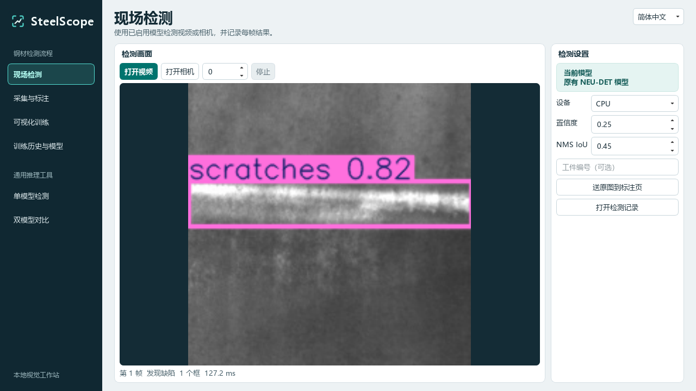

# SteelScope｜钢材表面缺陷检测工作台

## 项目介绍

面向钢材表面质检，构建基于 YOLO11n 的视觉检测工作台，识别划痕、夹杂、麻点等六类缺陷。系统支持抓取现场漏检样本，经过人工标注和审核后纳入后续训练，并对新模型进行试跑、启用和回退。

## 主要工作

- 使用 OpenCV 接入 USB 摄像头、本地视频及批量图片，在后台线程中执行推理。现场检测逐帧记录预测框、耗时和模型版本，批量检测按文件累计预测框，生成任务报告和类别分布。
- 实现视频抓帧、模型预标注、人工修框与审核，将审核样本导出为 YOLO 格式数据集。通过数据快照保存训练所用的图片、标签和数据划分，使训练任务可追溯到具体数据版本。
- 将 NEU-DET 的 1,800 张图像对应的 XML 框标注转换为 YOLO 格式，划分为 1,440 张训练图、180 张验证图和 180 张测试图。基于官方 YOLO11n 权重对比全参数微调、仅训练检测头、训练 Neck + Detect 三种方案。全参数微调在同一验证集上达到 **76.65% mAP@0.5** 和 **44.88% mAP@0.5:0.95**。
- 使用 PySide6 搭建检测、标注、训练和模型管理界面，通过 Qt 的 QProcess 在独立进程中执行训练，逐轮展示损失、验证 mAP 和日志。按任务保存数据版本、训练参数、指标和权重，支持候选模型样图试跑和版本切换。

## 技术栈

Python、PySide6、OpenCV、PyTorch、Ultralytics YOLO11n

## 界面预览

截图来自本地开发版本，展示了统一导航、检测画面及参数面板。
