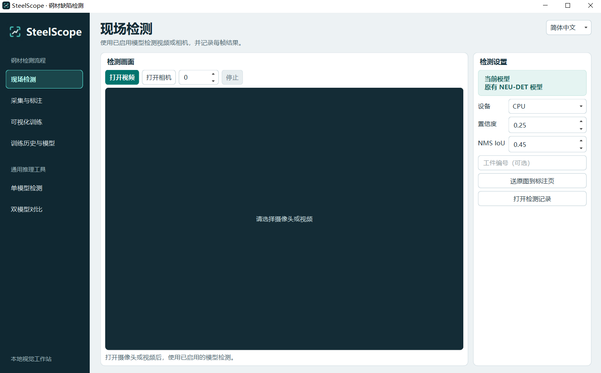
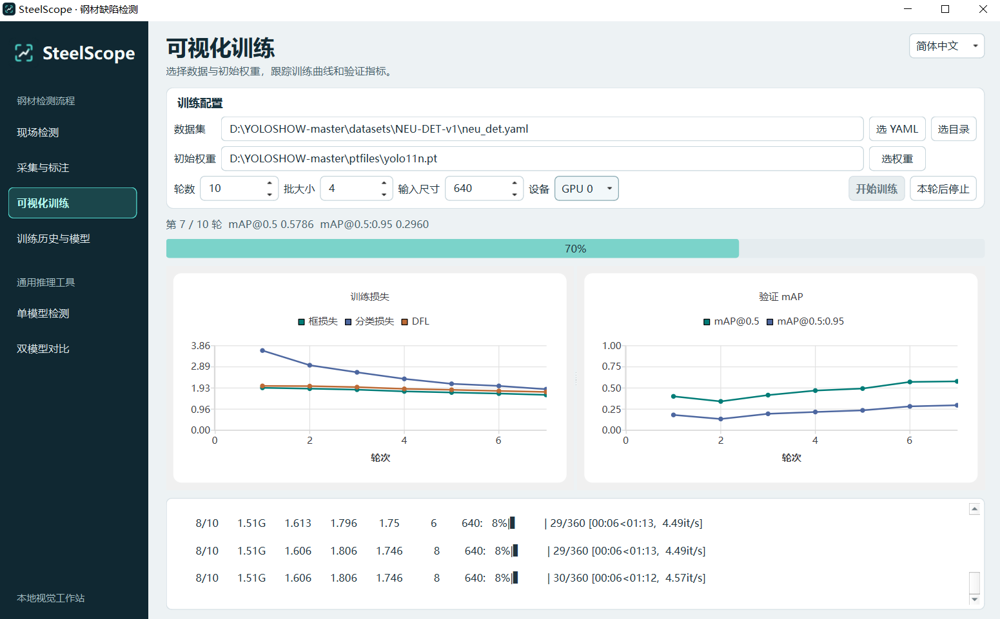

# SteelScope · 钢材表面缺陷检测工作台

[简体中文](#简体中文) · [English](#english) · [工作台截图 / Workbench](#workbench) · [安装与启动 / Setup](#setup) · [输出文件 / Outputs](#outputs) · [基线实验 / Results](#results)

## 简体中文

SteelScope 是一个面向钢材表面质检的 PySide6 桌面工作台，使用 YOLO11n 检测划痕、夹杂、麻点等六类缺陷。操作员发现漏检时，可以抓取原图补框并审核，将样本加入下一版训练集。训练完成后，可以在模型库试跑候选模型，再手动启用或切回上一版。

**工作流程**　现场检测 → 抓帧与标注审核 → 生成数据集版本 → 可视化训练 → 试跑与启用

左侧导航还提供单模型检测和双模型对比，右上角可切换简体中文和 English。

**技术栈**　Python、PySide6、OpenCV、PyTorch、Ultralytics YOLO11n

## English

SteelScope is a PySide6 desktop workbench for steel surface defect detection with YOLO11n. It brings camera and video inspection, annotation, dataset versioning, training, and model activation into one window. The sidebar also provides single-model inference and side-by-side comparison. The interface is available in English and Simplified Chinese.

1. **Inspect** a USB camera feed or local video. The workbench overlays detections and records each processed frame with its timing and model version.
2. **Annotate** a captured raw frame by drawing boxes or correcting model suggestions. Human-reviewed annotations are saved as YOLO labels. Confirmed defect-free frames have empty label files.
3. **Export** a versioned dataset snapshot. When a base dataset is selected, new samples go into its training split and existing validation and test assignments are preserved.
4. **Train** with a selected dataset and checkpoint. A separate Python process runs Ultralytics while the GUI displays per-epoch losses, validation mAP, and logs.
5. **Review and activate** a completed model. Inspect the run history, try the candidate on a sample image, and activate it or roll back to the previous version.

## Workbench

### 现场检测 · Inspection

打开本地视频或 USB 相机后，使用当前启用的模型逐帧检测。界面预览缺陷框，后台记录每帧的预测框、处理耗时和模型版本。右侧可以调整设备、置信度和 NMS IoU。 [检测代码](workstation/inspection_page.py)

### 采集与标注 · Capture and annotation

从检测页发送原始帧，或直接在标注页抓帧。可以手动画框，也可以用当前模型预标注后再修改。人工审核后保存原图与同名 YOLO 标签。生成数据集版本时，若选用基础数据集，新样本进入训练集，沿用原来的验证集和测试集。 [标注代码](workstation/annotations.py) · [数据快照](workstation/dataset.py)

### 可视化训练 · Training

选择数据集、初始权重、轮数、批大小和设备后，由独立进程执行训练。截图记录了一次训练进行中的状态，界面同步显示进度、训练损失、验证 mAP 和日志。 [训练进程](workstation/train_worker.py)

### 训练历史与模型 · History and models

左侧查看任务对应的数据版本、初始权重和训练曲线。右侧模型库支持用样图试跑、启用所选模型和切回上一版。完成训练且生成 `best.pt` 的任务会进入模型库。 [模型库代码](workstation/store.py)

### 单模型检测 · Single-model inference

选择一份本地权重，对图片、视频或文件夹做推理。YOLO11 批量任务按文件累计预测框，结果表格和类别统计共用同一份任务报告。勾选「保存推理输出」可以保存带框的图片或视频。 [批量统计](yoloshow/inference_report.py)

### 双模型对比 · Model comparison

在左右两侧选择模型，用相同输入并排检查预测框。可以借此查看新旧模型在同一样本上的漏框、多框和位置偏差。 [双模型对比](yoloshow/YOLOSHOWVS.py)

## Setup

### 安装与启动 · Install and launch

在 Windows PowerShell 中运行。以下命令使用 Python 3.9 和 CPU 版 PyTorch。使用 NVIDIA GPU 时，请将 PyTorch 安装命令替换为与本机驱动兼容的 CUDA 版本。

Run these commands in Windows PowerShell. They use Python 3.9 and the CPU build of PyTorch. For NVIDIA GPU acceleration, install a CUDA build of PyTorch and torchvision compatible with your driver.

~~~powershell
git clone https://github.com/lnzz21/yolo-defect-detection.git
cd yolo-defect-detection
py -3.9 -m venv .venv
.\.venv\Scripts\python.exe -m pip install torch==2.8.0 torchvision==0.23.0 --index-url https://download.pytorch.org/whl/cpu
.\.venv\Scripts\python.exe -m pip install -r requirements.txt
.\.venv\Scripts\python.exe main.py
~~~

### 数据与权重 · Data and checkpoints

数据集、模型权重和运行记录存放在本地。首次运行时，准备与你要执行的步骤对应的文件。

Datasets, checkpoints, and run outputs are stored locally. Prepare the files needed for the steps you plan to run.

- **初始权重 / Training checkpoint** — 将官方 YOLO11n 预训练权重放到 `ptfiles/yolo11n.pt`，也可以在训练页选择本地 YOLO11 检测权重。 Place the official pretrained YOLO11n checkpoint at this path or select a local YOLO11 detection checkpoint in the training tab.
- **训练数据 / Training data** — 将 NEU-DET 原始图片和 XML 分别放在 `data/IMAGES/` 和 `data/ANNOTATIONS/`，执行下方转换命令。 Place the original images and XML annotations in those directories and run the conversion below.
- **检测权重 / Inspection checkpoint** — 在模型库启用工作台训练完成的模型。已有六类 NEU-DET 权重也可放到 `ptfiles/yolo11n_neu_det.pt`，重新打开工作台后会出现在模型库。 Activate a completed workbench model, or place an existing six-class NEU-DET checkpoint at this path and reopen the workbench to register it.

~~~powershell
.\.venv\Scripts\python.exe tools\prepare_neu_det.py
~~~

转换后选择 `datasets/NEU-DET-v1/neu_det.yaml` 进行训练。也可以直接选用符合 YOLO 格式的现有数据集。

Select the generated YAML in the training tab. You can also select an existing YOLO-format dataset.

## Outputs

| 产物 / Output | 位置 / Location |
| --- | --- |
| 现场检测会话与逐帧记录 / Inspection logs | `runs/workstation/inspections/` |
| 采集标注与数据集版本 / Annotations and dataset versions | `runs/workstation/annotations/`、`runs/workstation/datasets/` |
| 训练参数、日志、曲线与权重 / Training runs | `runs/workstation/jobs/` |
| YOLO11 单模型任务报告 / Single-model inference report | `runs/detect/exp*/summary.json` |

## Results

### NEU-DET 基线对比 · Baseline validation

项目将 1,800 张 NEU-DET 图片划分为 1,440 张训练图、180 张验证图和 180 张测试图。类别顺序为 `crazing`、`inclusion`、`patches`、`pitted_surface`、`rolled-in_scale`、`scratches`。

The project split contains 1,440 training, 180 validation, and 180 test images. The six class IDs follow the order listed above.

| 微调范围 / Fine-tuning scope | Precision | Recall | mAP@0.5 | mAP@0.5:0.95 |
| --- | ---: | ---: | ---: | ---: |
| 全参数 / Full model | 72.93% | 70.55% | **76.65%** | **44.88%** |
| 仅检测头 / Detect head only | 70.80% | 42.46% | 49.73% | 22.48% |
| Neck + Detect | 67.71% | **75.55%** | 75.85% | 44.01% |

表中是此前三种微调方案在同一验证集上的对比结果。三种方案使用相同的初始权重、数据划分和随机种子。全参数微调取得最高 mAP，Neck + Detect 取得最高召回率。

This table compares three earlier baseline experiments on the same validation set. The runs used the same initial weights, data split, and random seed. Full fine-tuning achieved the highest mAP, and Neck + Detect achieved the highest recall.

## 文档与许可 · Documentation and license

- [工作台操作、输出目录与模型评估 / Workbench guide (中文)](WORKSTATION.md)
- [项目介绍 / Project profile (中文)](PROJECT_PROFILE.md)
- [NEU-DET 数据转换、命令行训练与评估 / NEU-DET training guide (中文)](TRAINING_cn.md)
- [检测头对比脚本 / Detect-head experiment](tools/train_head_only.py) · [Neck + Detect 对比脚本 / Neck + Detect experiment](tools/train_neck_detect.py)
- 本项目基于 YOLOSHOW，采用 AGPL-3.0。 Built on YOLOSHOW and licensed under AGPL-3.0. [YOLOSHOW](https://github.com/SwimmingLiu/YOLOSHOW) · [原版功能说明 / Original feature guide (中文)](README_cn.md) · [LICENSE](LICENSE)
